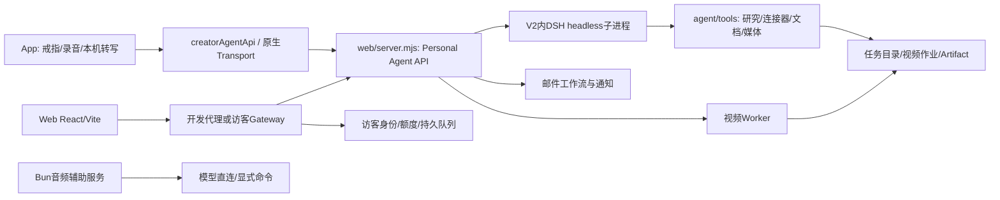

# Spur V2 第二阶段架构拆分方案

日期：2026年11月14日。依据：当前V2工作区源码、第一阶段迁移报告及现有构建/部署脚本。

**本轮仅分析与生成本文件，没有移动代码、修改配置、安装依赖、运行部署或操作生产。下文目录、内部接口和迁移步骤均为待确认方案，不代表已实现。** 当前线上部署状态未远程复查，部署描述以本地脚本及历史记录为依据。

## 一、推荐决策

建议先在一个仓库内完成 **Agent、App、Web三个产品模块的边界拆分**，稳定API和独立构建后，再分别建GitHub仓库。不要同时实施目录搬迁、框架升级、账号系统重做、数据库替换和多仓库发布。

| 产品模块 | 负责什么 | 不负责什么 |
| --- | --- | --- |
| Agent | 任务API、DSH编排、工具、研究、生成、文件交付、连接器、邮件工作流、服务端租户接入与额度 | 手机原生UI、蓝牙、Web React组件 |
| App | iOS/Android客户端、戒指连接、录音、本机识别、用户确认、移动端交互与安全存储 | 云端模型密钥、DSH/Python运行环境、独立复制一套Agent后端 |
| Web | 浏览器UI、任务/视频展示、前端交互和静态资源构建 | DSH执行、平台刷新令牌、服务器作业与访客调度 |

“三个模块”不是强制只有三个进程。Agent模块可以维护API Worker、接入网关、音频辅助服务等不同部署单元；它们属于同一个后端产品边界。初期不再拆成大量微服务。

音频云端推荐归属Agent，以独立Bun服务保留。Java配套后端先归为Agent历史参考实现，不启用、不替代Node/Bun；移动端仓库不应长期携带一个与实际生产Agent平行的后端。

## 二、当前真实调用链与证据

### 2.1 当前关系图



此图表达源码调用关系，不表示图中每条服务今天均在生产启用。

| 现状 | 源码证据 | 对拆分的影响 |
| --- | --- | --- |
| Node服务位于Web目录，但实际是Agent后端 | `web/server.mjs` 导入DSH启动、邮件、OAuth、视频Worker和鉴权模块 | 不能把整个 `web/` 直接作为纯前端仓库 |
| App当前聊天已走Personal Agent | `appV2/app_mobile/src/services/chatApi.ts` 的 `chat()` 调用 `runCreatorAgentTask()`；`creatorAgentApi.ts` 提交 `/api/creator-agent/chat` | App应对接统一Agent契约，不再建立App专属聊天后端 |
| App转写留在手机 | `services/transcriptionApi.ts` 调用 `phoneAudio.transcribeRecording`，明确无云端回退 | 不因为合并音频服务而默认上传原始录音 |
| 仍保留音频服务地址和健康检查 | `chatApi.ts` 的 `getApiUrl()`、`testApiConnection()` 校验 `/health` 的audio-agent响应 | 残留能力需逐调用者核对，不能因聊天改路由就删除配置 |
| Java路径关闭 | `src/config/backend.ts` 中 `JAVA_AGENT_ENABLED=false`；`src/agent/client.ts`、`runtime.ts`、`settings.ts` 有对应守卫 | Java不是当前主Agent链；原接口仍需留档 |
| Bun服务独立执行 | `cloud/audio-agent/src/server.ts`、`agent.ts`，模型直连或显式命令 | 保留协议，不强制改为DSH调用 |
| 访客入口管理身份与调度 | `web/guest/gateway.mjs`、`access.mjs`、`queue.mjs` | 属于后端接入层，不能随前端打包到浏览器 |
| DSH只使用V2副本 | `web/server.mjs` 的 `harnessBinary()`；研究CLI亦已取消父目录回退 | 拆分后继续固定Agent内部运行时，不能再引入跨模块回退 |

第一阶段报告和早期README中关于音频/聊天的历史描述不能替代本次源码：**当前 `chat()` 已走Personal Agent，音频服务不是App全部聊天的默认执行器。**

### 2.2 `web/server.mjs` 的混合职责

| 当前函数/区域 | 实际职责 | 建议归属 |
| --- | --- | --- |
| `readEnvFile()`、readiness、Node/Harness选择 | 服务配置与执行环境 | `agent/services/api` 的配置/启动层 |
| `makePrompt()`、`makePatch()`、`runHarness()` | 产品提示词、工具白名单、DSH子进程和时限 | `agent/lib/orchestration` |
| chat/tasks路由、`activeRequests`、任务JSON | 提交、去重、并发、任务状态 | `agent/lib/tasks` + API适配层 |
| `collectRunData()`、`persistArtifactIndex()`、`secureRunData()` | 计划/活动/成果归集、索引和签名 | `agent/lib/artifacts` |
| `AppConnections`、YouTube旧OAuth路由 | 授权绑定、刷新凭据与回调 | `agent/lib/connectors` |
| email路由、`EmailWorkflow`、`MailNotifications` | 收件、摘要、草稿、批准发送、防重复 | `agent/lib/email` |
| 视频模块导入与启动、视频API | 作业、状态、Range交付、渲染进程生命周期 | `agent/lib/media` + 工具/Worker |
| `sameLocalOrigin()`、Bearer/签名校验 | 本地开发与远程API安全边界 | `agent/lib/security`、接入适配层 |
| `safeStaticPath()`、dist fallback | Web静态文件服务 | 最终由Web交付/边缘静态服务承担；过渡期保留兼容适配 |

这里优先做函数/模块抽取，不马上引入新Web框架。建议内部采用 `createAgentServer(dependencies)` 与显式 `start/stop`；导入模块不自动监听端口、开定时器或启动Worker。具体命名待实施时确定。

## 三、目标目录与独立交付边界

建议布局如下；`packages/` 是共享契约，不是第四个业务后端：

```text
V2/
  agent/
    services/
      api/                    # 原web/server.mjs的API入口和路由
      access-gateway/         # 访客会话、队列、额度、同源转发
      audio/                  # 原cloud/audio-agent，保留Bun边界
      office-gateway/         # 原agent/gateway，固定办公流程
    lib/
      orchestration/          # Prompt、Patch、HarnessRunner
      tasks/                  # TaskService、持久化访问
      artifacts/              # 成果索引、签名、下载
      connectors/             # OAuth/凭据存储/刷新
      email/                  # Mail工作流和通知
      media/                  # 视频交付及Worker生命周期
      security/               # 身份上下文、校验、授权策略
      config/                 # 路径及环境参数解析
    tools/                    # 现有工具保留，逐个修正内部路径
    runtime/                  # DSH、MCP及外部执行引擎，各自依赖锁
    integrations/             # CLI/研究入口
    legacy/java-reference/    # 原Java配套工程，明确非默认生产服务
    assets/                   # 后续显式归集构建必需媒体资产
    tests/
    deploy/
    package.json              # API/网关开发测试命令，不接管所有上游依赖
  app/
    mobile/                   # 原appV2/app_mobile整体，含ios/android/SDK
    docs/
  web/
    src/
    public/
    tests/
    dev/                      # 本地开发桥，不是生产授权服务
    deploy/                   # 静态资源/同源代理交付
    package.json
  packages/
    contracts/                # API规格、纯DTO、样例与兼容性检查
    client-core/              # 可选：平台无关请求/轮询；按实际收益抽取
  integration/                # 跨模块验收和开发环境编排
  docs/
```

分清三个层次：

- 产品模块：Agent/App/Web。
- 源码包：契约、客户端核心、Agent内部库。
- 运行单元：网关、API Worker、音频辅助服务、可选媒体Worker。

先继续使用现有npm、pnpm、Bun和Maven锁文件。App React19/RN0.82与Web React18不强制统一；DSH保留独立pnpm workspace。不要为了根目录统一安装命令而提升/合并所有依赖版本或hoist原生依赖。

## 四、具体代码迁移映射

| 当前路径 | 目标位置/策略 | 迁移约束 |
| --- | --- | --- |
| `web/server.mjs`、`start.mjs` | API路由/CLI到 `agent/services/api/`，执行逻辑到agent/lib | 先抽逻辑、保留旧启动兼容入口，最后移除shim |
| `web/task-results.mjs`、`performance.mjs` | `agent/lib/tasks/`、执行观测层 | 保持历史JSON和恢复逻辑 |
| `web/creator-agent-auth.mjs` | `agent/lib/security/` | 保持签名算法、密钥与有效期，不重置Token |
| `web/video-stream.mjs` | `agent/lib/media/` | 保持GET/HEAD/Range、Content-Type和下载头 |
| `web/app-connections.mjs`、`youtube-oauth.mjs` | `agent/lib/connectors/` | 原类两入口共用，旧OAuth路线先兼容，不合并用户作用域 |
| `web/email/*` | `agent/lib/email/` | 保留全部批准、编辑版本、重复发送保护及测试 |
| `web/guest/*`服务代码 | `agent/services/access-gateway/` | 身份与队列属于后端；部署脚本归agent/deploy |
| `web/guest/login.js/html` | 可继续作为网关小型静态资产；通用首页UI仍在web | 第一轮不重写登录交互，交付清单需包括这些资产 |
| `web/cloud-bridge.mjs`、连接脚本 | `web/dev/` | 单用户本地代理，凭据仅服务端读取，不当公网网关使用 |
| `web/src/*` | 继续留 `web/src/` | 纯UI/客户端适配；移出定义在组件里的通用协议类型 |
| `cloud/audio-agent/` | `agent/services/audio/` | 保持Bun、8787默认端口、现有接口与数据路径覆盖 |
| `appV2/app_mobile/` | `app/mobile/` | 整体迁移原生项目，不与根旧App混合；复核Podfile、Gradle、Metro与脚本 |
| `appV2/app_server/` | `agent/legacy/java-reference/` | 移动前需负责人确认无其他活跃消费者；不自动启动 |
| `agent/gateway/` | `agent/services/office-gateway/` | 与访客gateway不是同一个服务，不能按名称误合并 |
| `agent/tools`、`runtime` | 保持Agent内部 | DSH工具可以依赖Agent领域库，不能反向导入API服务器 |
| 现有Linux/ECS脚本 | 留历史版本，新增新布局的发布适配器 | 不能直接把旧脚本所有web字样批量替换 |
| docs内必需媒体素材 | 后续进入 `agent/assets/`，docs留来源链接 | 先列清单、保留署名与许可证；不搬所有验证成片 |
| `scripts/verify-independent-agent.mjs` 等 | 放入Agent测试或integration，更新入口 | 保留第一阶段禁止读取根目录的验证，再增加禁止跨产品源码导入 |

Java有AgentStore、动作确认、记忆与任务等实现，可作为设计参考；不能因为Node暂未实现其中某项，就直接复制整套模型或同时启用两个“事实来源”。

## 五、API与共享契约策略

### 5.1 第一轮冻结现有外部协议

不立即新增 `/api/v1` 并强迫App升级，不重命名现有字段。用契约版本描述当前协议，保持外部路径不变。

| 路径/方法 | 现有语义 | 拆分后负责人/兼容要求 |
| --- | --- | --- |
| `GET /api/creator-agent/health` | ready/reasons等状态 | Agent API；保持现有鉴权，不把模型Key暴露给客户端 |
| `POST /api/creator-agent/chat` | requestId、message、history、async；异步202 | Agent任务；保留同步兼容、409重复回执，未知结果先GET不重投 |
| `GET /api/creator-agent/tasks/:id` | running/finished/failed、result、plan、activity | Agent任务；保留404隐藏其他身份资源 |
| `GET /api/creator-agent/artifacts/:id` | 文档/图片交付，Bearer或有效签名 | Agent成果；保持签名与下载头 |
| `GET /api/creator-agent/videos`、`GET /api/creator-agent/videos/:id` | 视频列表与状态 | Agent媒体；访客网关现有白名单并未开放全部同名操作 |
| `GET/HEAD /api/creator-agent/videos/:id/file` | 播放、下载、Range | Agent媒体；必须通过所有者校验或既有安全转发 |
| `POST /api/creator-agent/videos/:id/retry` | paused状态恢复查询，有本地来源限制 | 暂不扩大权限，不误改成重新付费生成 |
| `/api/creator-agent/connections/*` | profile创建、状态、YouTube/Notion连接与断开 | Agent连接器；保留X-Spur-Connection和现有绑定 |
| `GET /api/connections/callback/{youtube,notion}` | 授权结果回调 | 保留域名、路径、state校验及过期语义 |
| `/api/youtube/oauth/start`、`/callback` | 旧个人OAuth入口 | 兼容保留，先确认调用者再废弃 |
| `/api/creator-agent/email/*` | 状态、邮件、摘要、草稿、批准、回复、通知 | Agent邮件；现有本地来源与批准限制不变，访客不因拆分获得邮箱权限 |
| `POST /api/guest/login`、`/logout` | 邀请兑换与Cookie会话 | Agent接入网关，静态首页仍可匿名展示 |
| `/api/guest/connections/*` | 当前访客YouTube授权管理 | Agent接入网关；不与个人账户授权池合并 |
| `GET /api/web-backend` | 客户端识别运行模式/scope | Web接入适配，保留guest/cloud/local分支 |

音频与Java不并入上述路由：

| 服务 | 现有协议证据 | 决策 |
| --- | --- | --- |
| Bun音频 | `src/server.ts`：`/health`、`/api/chat`、`/api/assistant/*`、`/api/audio-task`、本地转写/媒体/recordings接口 | 保留原协议和默认端口；音频辅助及历史兼容归Agent，是否逐接口废弃需调用者证据 |
| Java | `ChatController.java`：`/api/health`、`/api/chat`返回content、`/api/chat/stream`；`AgentController.java`：`/api/agent/*` | 禁止与Bun的同名路径不加区分地挂到同一上游；保留参考且默认不启动 |

### 5.2 契约内容与版本

建议 `packages/contracts` 首先包含任务/成果/视频/连接状态的协议规格、JSON样例、纯TypeScript DTO与错误语义，规格作为事实来源，不把服务端类直接作为客户端类型。

必须分别表达：

- 请求用 `requestId`、服务响应多用 `runId`；App的客户端结果映射不能随便改名。
- Agent终态是 `finished`，视频终态是 `completed`；Web的 `submitting/unknown` 是UI状态，不能冒充服务端状态。
- 访客排队位于 `queue.state/position/active/limit`；当前排队快照的顶层status仍是running，不直接改成queued。
- `AgentResult` 包含response、sources、artifacts、可选media/videoJobs/plan；App当前只消费其中一部分，应保留向后兼容的可选字段。
- 成果公开URL不能当服务器磁盘路径；错误先兼容现有 `{error:string}`，稳定错误码可后续加可选字段，不能一次替换所有响应格式。
- 401、403、404、409、413、429、503与未知提交结果的客户端行为需要契约测试，不只共享类型定义。

`web/src/taskApi.ts` 当前从UI组件 `VideoTask.tsx` 导入协议类型；拆分时先把纯 `VideoJob` DTO放契约，组件单向引用契约，避免共享包依赖React。

### 5.3 客户端共享方式

可选 `client-core` 只抽取平台无关的任务ID核验、快照解析、错误映射与轮询决策；通过fetch/transport注入，不读取环境变量，不持有Cookie/Token，不导入React、React Native、Node fs或DSH。

Web保留Cookie/同源适配，App保留 `SpurIdentity` 安全存储、`creatorAgentTransport.ts`、取消与网络错误处理。不要用浏览器fetch简单替换已验证的iOS传输。

单仓库阶段可以版本化本地契约包；未来多仓库使用锁定版本的私有包或发布的生成产物，不能继续使用跨仓库 `../../`、共享node_modules或依赖个人磁盘路径。每次协议兼容变更须同时运行Agent提供方和两个客户端消费方测试。

## 六、依赖方向与循环依赖防线

```text
App ──→ 契约/可选client-core ←── Web
                 ↑
              Agent API
                 ↓
      Agent领域服务 → 存储/模型/连接器适配
                 ↓
        DSH Runner → 注册工具 → 领域服务接口
```

图中工具通过注入服务接口或低层领域库使用能力，不反向导入Runner、监听端口入口或API路由；否则Runner注册工具后会形成加载环。

| 潜在循环/耦合 | 当前依据 | 拆分约束 |
| --- | --- | --- |
| Agent运行依赖Web源码 | server在web内，Docker复制web后端与dist | 后端迁出；静态dist只能是可选交付物，不作为API启动前提 |
| Web契约依赖UI组件 | taskApi从VideoTask导入类型 | 类型下沉，不将组件移到公共包 |
| 网关依赖API实现 | guest/gateway导入同级上层AppConnections | 两者共同依赖Agent连接器库，不互相import服务入口 |
| 视频工具依赖另一个provider的作业实现 | openmontage导入video-generation/jobs.cjs，后者亦包含Worker逻辑 | 先在Agent内部抽纯JobStore接口，保留provider Worker；不要因本轮拆分立即独立成远程服务 |
| 工具写任务文件与API读文件 | SPUR_RESEARCH_OUTPUT、tool-events/plan/result | 这是已有文件协议，先保留并文档化；未来如改事件总线需另立迁移任务 |
| 共享包依赖Node/原生SDK | App/Web执行环境不同 | contracts/client-core只能含可移植代码；密钥、日志文件、存储适配留后端 |
| 音频服务再调用自己 | 后续如改AUDIO_AGENT_AGENT_COMMAND或同名/api/chat路由 | 明确上游地址与单向调用，不借同域名隐式递归 |

不把“Memory/Idea”示例页当后端模块抽取依据：`MemoryPage.tsx`、`IdeaPage.tsx`仍使用演示数据；`agent/memory`等规划目录也不能直接变成新生产服务。

## 七、鉴权、数据与任务兼容策略

### 7.1 保持身份边界

| 场景 | 必须保留 |
| --- | --- |
| App/个人API | Bearer、X-Spur-Connection、现有设备安全存储；不以客户端传入userId替代所有者校验 |
| Web访客 | 邀请一次兑换、约30天Cookie会话、服务端tenant→worker映射、任务/文件/视频所有权索引 |
| Gateway到Worker | Worker独立Token及现有授权字段转发白名单；不把浏览器任意环境字段转发进执行器 |
| 平台授权 | AppConnections配置、凭据加密、租户绑定与OAuth state；不回退开发者私有授权 |
| 邮件 | 草稿编辑与批准后发送、版本/重复保护、来源限制；未批准永不发送 |
| 浏览器部署 | 保持同源代理与CSRF/Host检查；不为了跨仓库开发开放CORS通配或把Bearer塞入前端构建变量 |

目标内部 `RequestContext` 可表达经校验的主体/租户/连接身份/允许能力，但它必须从既有鉴权适配器生成，不由请求体直接信任，也不在本轮统一替换账号体系。

### 7.2 代码迁移与数据迁移分开

| 数据/依赖 | 当前证据 | 第一轮策略 |
| --- | --- | --- |
| 任务目录 | `web/.runtime/runs/:id`，task/result/terminal/plan/events | 显式传SPUR_RUNTIME_ROOT，先保留原卷与磁盘布局，不随源码位置重建空目录 |
| Artifact索引 | `persistArtifactIndex()`保存绝对磁盘路径；内存Map在查询历史任务时恢复 | 保留旧容器挂载路径、签名Key及恢复顺序；先测历史任务和旧链接，不自动改路径格式 |
| OAuth凭据 | AppConnections保存 `app-connections/encryption.key` 和加密记录 | 整体保留同一数据卷，不能只复制密文而生成新key；任何备份不输出凭据 |
| Web访客 | access/queue、workers注册及所有权索引 | 保留单写者、Cookie作用域与现有文件，禁止两个网关进程共写JSON |
| 视频作业 | video-jobs JSON、原provider requestId、MP4与日志 | 不自动重提付费作业；保留global render lock路径和每用户数据隔离 |
| App本地数据 | AsyncStorage、本机文件、原生安全凭据、Bundle ID | 移源码不改存储键/身份/签名，不卸载清数据验收 |
| Web本地历史 | App.tsx的localStorage按scope保存 | 不改域名/站点作用域及storage key；协议升级不清空历史 |
| 音频服务数据 | config按appRoot构造data/media路径 | 移源码前配置显式旧数据目录，不能无意换到空库或改变允许读取的音频根 |

`maxRunMs`当前为8分钟；异步HTTP并不保证任务可跨重启连续执行数天。OpenMontage Worker启动会把遗留generating作业标失败。迁移发布必须先阻止新提交、排空活动任务再切换；这是未来实施要求，本轮未操作。

## 八、独立构建与部署方案

| 产物 | 建议 | 与其他模块关系 |
| --- | --- | --- |
| Web静态产物 | Web单独构建dist、独立静态镜像或资源包 | 不要求编译DSH/安装Python；通过同源API代理连接Agent |
| Agent API镜像 | 构建DSH、Node API与启用工具，媒体依赖沿用现有镜像分层 | 不COPY Web React源码、不要求dist存在才能health/执行任务 |
| 接入网关镜像 | 仅Node网关及后端所需连接器库 | 不再为了运行网关携带完整DSH/Chrome/FFmpeg镜像 |
| 音频辅助服务 | 保留Bun独立产物 | 不要求启动Java，按需部署 |
| App | RN自身依赖、iOS/Android工具链和签名 | API契约与测试桩即可开发，不要求本地完整Agent媒体环境 |
| Java参考工程 | 默认不纳入生产compose/build | 需恢复时单独评估消费者、路由冲突和数据所有权 |

当前Dockerfile同时构建DSH和Web、复制 `web/*.mjs`、CMD执行 `node server.mjs`；OpenMontage镜像又基于 `research-async-v3` 并覆盖web与工具。必须同步维护新构建上下文、COPY、健康检查、准备脚本和版本清单，否则“源码拆了，镜像仍绑一起”。

现有ECS脚本对 `/opt/spur/V2/web/server.mjs`、`app-connections.mjs`、`.runtime`、挂载白名单及旧发布目录有硬编码。初期允许通过构建适配保留旧容器文件布局/卷路径，**旧路径名称可以暂留，但不再构成Agent对Web源码的依赖**。新布局使用新版本部署脚本，历史升级脚本归档说明，不盲目重跑。

域名及外部端口第一轮不变：个人API仍走既有域名，Web访客仍走既有站点；Gateway默认4190、Worker默认4173及现有loopback映射保持兼容。未来改变端口/域名要单独验收Caddy、OAuth回调及客户端设置，不能捆绑在拆目录中。

独立部署意味着可以分别发布版本，并非请求运行时完全不需要对方服务。Web/App可以对桩开发；真实任务仍需要可用Agent和已启用工具服务。

## 九、建议迁移顺序与验收门槛

每一步应形成一个可审查、可回滚的小变更；不先搬完所有目录再统一修报错。

| 批次 | 内容 | 验收门槛 |
| --- | --- | --- |
| 0：冻结基线 | 盘点未提交内容、确认App4项失败的有效产品预期、记录接口与发布/挂载清单 | 队友确认基线；不掩盖现有失败，禁止新增失败 |
| 1：协议先行 | 建立contracts及现有响应样例；先解耦VideoTask DTO，不改URL/字段 | App/Web消费方与服务端契约测试通过，鉴权负例覆盖 |
| 2：抽Agent执行层 | 提取配置、Runner、任务、成果、连接器、邮件；server仍保留旧入口 | 第一阶段独立DSH任务闭环、状态/下载/邮箱/连接器回归；无循环导入和导入副作用 |
| 3：建立Agent API入口 | 新CLI从agent启动；旧web/server仅临时转发兼容 | API无需Web源码/dist启动；旧客户端仍可调用；旧入口明确废弃期限 |
| 4：迁接入网关 | guest服务与部署工具移入Agent；Web保留静态页面和开发代理 | 邀请、排队、并发2、额度、跨租户404、YouTube访客授权、Range均通过 |
| 5：Web独立交付 | 移除生产后端依赖，分别构建静态产物和Agent镜像 | Web仅靠契约和API配置构建；Agent不构建Web；保留同源/回调和匿名首页 |
| 6：音频与Java归位 | Bun服务迁入Agent；Java在确认消费者后归档；不改功能 | Bun接口/数据路径兼容；Java仍禁用；无同名路径误路由 |
| 7：App目录归位 | app_mobile整体迁至app/mobile，调整本地构建脚本 | lint/类型/已确认测试、iOS/Android构建及录音→本机识别→Agent真机闭环 |
| 8：隔离验收与发布准备 | 更新Docker/小包/健康检查/测试脚本，准备新布局canary与回滚清单 | 独立安装构建、旧数据回读、幂等与权限通过；之后另获发布确认再操作生产 |

App纯目录搬迁放后面，让移动端同事先通过稳定HTTP协议继续工作，不被后端拆分反复打断。媒体Worker进程独立、数据库替换和长期任务恢复均不作为本次架构拆分的附带要求。

## 十、验证矩阵与回滚原则

| 验证范围 | 必须覆盖 |
| --- | --- |
| 边界 | Agent禁止import App/Web源码；Web/App禁止import Agent实现；contracts无平台依赖；保持禁止根旧工程依赖 |
| 独立开发 | App和Web可以对版本化桩运行；Agent可以不安装UI依赖启动和测试 |
| 任务 | 202、重复409、回执丢失先GET、队列/执行/失败/完成、请求取消不误宣称后台已停止 |
| 数据 | 旧task/result回读、旧Artifact链接与签名、重启恢复、视频Range、凭据解密、存储键不变 |
| 安全 | 匿名401、跨身份/租户404、来源/CSRF、回调state、防目录穿越；不扩大网关白名单 |
| 额度与并发 | 保持总Agent2、媒体渲染1及现有每日额度；连接断开不释放仍在运行的任务名额 |
| 媒体/邮件 | provider请求号保留、重启不重复付费生成、未批准草稿不发送、重复批准/发送防护 |
| 构建发布 | Linux AMD64镜像实测、非root与只读容器写入路径、原生绑定加载器、卷UID/GID及挂载覆盖版本 |

第一阶段95项Web、33项工具、5项音频测试及沙箱DSH闭环可作为回归资产，不代表拆分后自动通过。App4项现有失败、Docker daemon未运行的边界仍然成立；本轮未重新运行测试。

回滚应同时记录镜像digest、后端文件覆盖版本、静态资源版本、契约版本、启动参数与卷映射。迁移初期不改数据格式，降低回滚难度；不得让新旧网关同时共写JSON。数据备份/恢复与任务排空方案须在真实发布前确认，不以回滚镜像替代数据一致性处理。

## 十一、4–5人协作与未来分仓

| 负责人 | 主责目录 | 协作约束 |
| --- | --- | --- |
| Agent执行负责人 | agent/lib/orchestration、tasks、tools、runtime | 工具只依赖领域接口，保持执行/权限白名单 |
| 后端接入与交付负责人 | API、access-gateway、connectors、email、deploy | 协调身份、持久数据和发布；审核不可逆动作路径 |
| App负责人 | app/mobile | 原生SDK、录音与安全存储；不改后端实现来适配UI |
| Web负责人 | web | UI、静态交付、Web transport；不持有服务端Key |
| 可选第五人：质量/契约负责人 | packages/contracts、integration、发布清单 | 契约兼容与跨端验收，避免共享包无人维护 |

四人时由后端接入负责人兼顾契约/发布，两个客户端负责人参与契约审核。共享协议变更至少由后端和受影响客户端共同审核；DSH/上游vendor更新单独变更，不混入业务搬迁。

满足以下条件后再考虑 `spur-agent`、`spur-app`、`spur-web` 分仓：

1. 各模块在只提供契约发布包/工具链的隔离环境中能安装、构建、测试，无跨目录源码引用。
2. API兼容窗口、客户端版本和发布/回滚清单已明确；契约包已有版本与分发方式。
3. 任何单模块改动无需编辑另一个仓库的内部实现；跨端功能通过契约与联合验收协调。
4. 外部引擎版本、许可证与本地补丁归属清楚；不把私人配置、依赖缓存、平台会话和大体积验证成片提交到新仓库。

## 十二、待确认事项与下一步建议

推荐确认：采用“单仓库先拆边界、冻结现有API、Agent统一持有服务端能力、App/Web保留各自传输与界面”的方案；首批仅做 **批次0–2**，不马上迁全部目录。

需要明确的产品/工程取舍：Java是否存在其他活跃消费者；音频旧接口实际保留清单；App4项展示/文案失败以哪版产品设计为准；契约包的分发方式；是否接受网关归Agent维护；哪些docs媒体资产是发布必需输入。

**本轮交付是拆分设计，所有代码迁移、接口实现、构建变更和部署操作均等待确认。**
